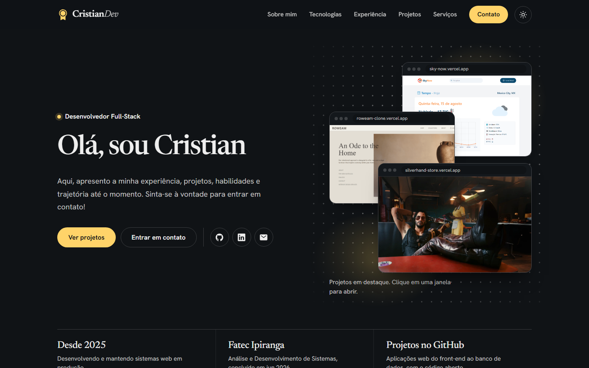

# 🌐 Portfólio - Cristian Daniel



> Bem-vindo(a) ao meu portfólio! Este repositório apresenta a minha experiência, formação, habilidades técnicas e projetos como desenvolvedor Full-Stack.

---

## 🎯 Objetivo

O meu objetivo com este portfólio é apresentar minhas experiências, competências e realizações para novos empregadores, colaboradores e pessoas interessadas no meu trabalho. Também para facilitar o contato com profissionais da área de tecnologia.

---

## 💻 Tecnologias Utilizadas no Portfólio

O site foi desenvolvido com **tecnologias vanilla**, e o motivo é simples: nem tudo precisa ser feito com framework, e pretendo manter o portfólio com vanilla puro. O **Vite** é usado apenas como ferramenta de desenvolvimento e build. Além disso, foi feito com foco em performance, responsividade e acessibilidade.

- **HTML**
- **CSS** (dividido em arquivos por base, componentes, layout e seções)
- **JavaScript** (módulos ES, um por funcionalidade)
- **Vite**

Recursos do site:

- Tema claro e escuro, seguindo o sistema ou a escolha do visitante
- Menu mobile acessível (teclado e leitores de tela)
- Filtro de projetos
- Botão para copiar o e-mail

---

## 🚀 Habilidades Técnicas

Aqui estão algumas das tecnologias e ferramentas que utilizo, organizadas por categoria:

| 🧩 Categoria        | 🛠️ Tecnologias                                                                                |
| ------------------- | --------------------------------------------------------------------------------------------- |
| **Front-End**       | React, Angular, AngularJs, TypeScript, JavaScript, HTML, CSS, Tailwind, jQuery, Bootstrap, TanStack Query, Framer Motion |
| **Mobile**          | React Native                                                                                  |
| **Back-End**        | Node.js, NestJS, Express, Spring Boot                                                         |
| **Banco de Dados**  | PostgreSQL, MongoDB                                                                           |
| **Testes**          | Playwright, Karma, Jasmine, Jest                                                              |
| **Infraestrutura**  | Docker                                                                                        |
| **Ferramentas**     | Git, GitLab, GitHub, VS Code, Claude                                                          |

Para mais detalhes, acesse meu [portfólio online](https://cristiandaniel1.github.io/portfolio/).

---

## 🗂 Estrutura do Portfólio

- **Sobre Mim:** quem sou, formação e principais tecnologias.
- **Tecnologias:** ferramentas que uso, organizadas por categoria.
- **Experiência:** minha trajetória profissional e as tecnologias de cada cargo.
- **Projetos:** projetos em destaque, com filtro por tipo, links para o site e para o código.
- **Serviços:** o que faço e como trabalho.
- **Contato:** e-mail e redes sociais.

---

## 📁 Estrutura do Código

```
├── index.html
├── public/
│   ├── favicon.png
│   └── theme-init.js      # aplica o tema antes da primeira pintura
├── docs/                  # imagens do README
└── src/
    ├── main.js            # ponto de entrada: inicializa os módulos
    ├── assets/            # imagens e ícones
    ├── js/
    │   ├── modules/       # uma funcionalidade por arquivo
    │   └── utils/
    └── styles/
        ├── main.css       # importa os demais arquivos na ordem certa
        ├── base/          # tokens, reset, estilos globais e animações
        ├── components/    # botões, chips e seções
        ├── layout/        # cabeçalho e rodapé
        └── sections/      # um arquivo por seção da página
```

---

## 🛠 Como rodar localmente

É necessário ter o [Node.js](https://nodejs.org/) instalado.

```bash
# Clone o repositório
git clone https://github.com/CristianDaniel1/portfolio.git

# Acesse a pasta do projeto
cd portfolio

# Instale as dependências
npm install

# Rode em modo de desenvolvimento
npm run dev

# Gere a versão de produção (pasta dist/)
npm run build

# Visualize a versão de produção localmente
npm run preview
```

---

## 📬 Entre em Contato

- 🌐 [LinkedIn](https://www.linkedin.com/in/cristiandaniel1)
- 📧 [Email](mailto:cristiandaniel.1050@gmail.com)

---

## 📄 Licença

Este projeto está licenciado sob a Licença MIT. Veja o arquivo [LICENSE](LICENSE) para mais detalhes.
