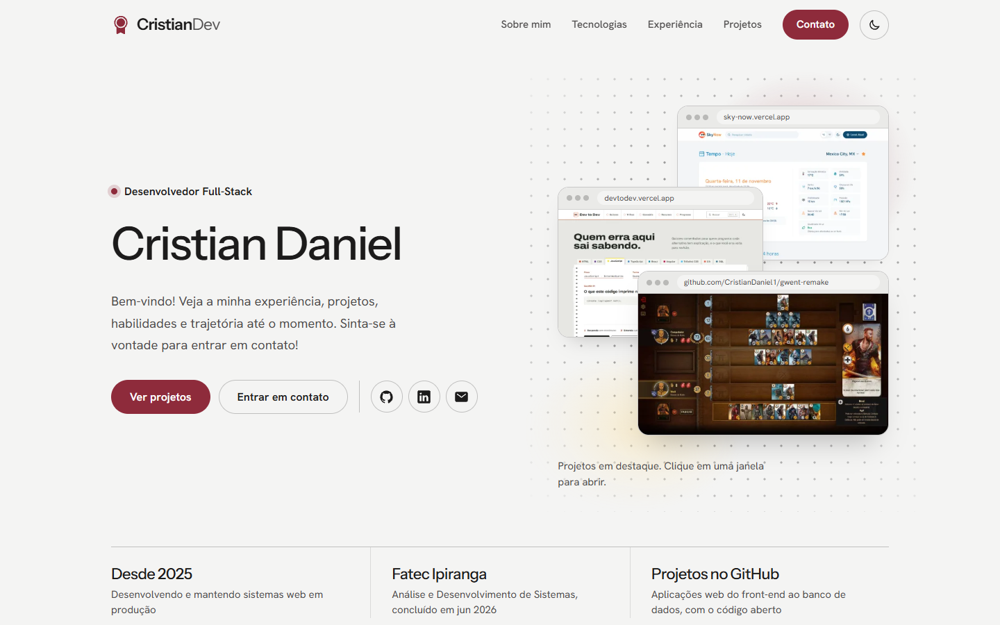

[](https://portfolio-cristiandev.vercel.app/)

Bem-vindo(a) ao meu portfólio! Este repositório apresenta a minha experiência, formação, habilidades técnicas e projetos como desenvolvedor Full-Stack.

🔗 **Acesse:** [portfolio-cristiandev.vercel.app](https://portfolio-cristiandev.vercel.app/)

## Tecnologias Utilizadas no Portfólio

O site foi desenvolvido com **tecnologias vanilla**, e o motivo é simples: nem tudo precisa ser feito com framework, e pretendo manter o portfólio com vanilla puro. O **Vite** é usado apenas como ferramenta de desenvolvimento e build. Além disso, foi feito com foco em performance, responsividade e acessibilidade.

- **HTML**
- **CSS** (dividido em arquivos por base, componentes, layout e seções)
- **JavaScript** (módulos ES, um por funcionalidade)
- **Vite**
- **Fontsource** (fontes Instrument Sans e Hanken Grotesk hospedadas no próprio site)

Recursos do site:

- Tema claro e escuro, seguindo o sistema ou a escolha do visitante
- Menu mobile acessível (teclado e leitores de tela)
- Filtro de projetos
- Botão para copiar o e-mail

---

## Habilidades Técnicas

Aqui estão algumas das tecnologias e ferramentas que utilizo, organizadas por categoria:

| Categoria          | Tecnologias                                                                                                              |
| ------------------ | ------------------------------------------------------------------------------------------------------------------------ |
| **Front-End**      | React, Angular, AngularJS, TypeScript, JavaScript, HTML, CSS, Tailwind, jQuery, Bootstrap, TanStack Query, Framer Motion |
| **Mobile**         | React Native                                                                                                             |
| **Back-End**       | Node.js, NestJS, Express, Spring Boot, Socket.IO                                                                         |
| **Banco de Dados** | PostgreSQL, MongoDB                                                                                                      |
| **Testes**         | Playwright, Karma, Jasmine, Jest                                                                                         |
| **Infraestrutura** | Docker                                                                                                                   |
| **Ferramentas**    | Git, GitLab, GitHub, VS Code, Claude                                                                                     |

Para mais detalhes, acesse meu [portfólio online](https://portfolio-cristiandev.vercel.app/).

---

## Estrutura do Portfólio

- **Sobre Mim:** quem sou, formação e principais tecnologias.
- **Tecnologias:** ferramentas que uso, organizadas por categoria.
- **Experiência:** linha do tempo da minha trajetória profissional, com as tecnologias de cada cargo.
- **Projetos:** projetos com imagem, tecnologias, filtro por tipo e links para o site e para o código.
- **Contato:** e-mail e redes sociais.

---

## Estrutura do Código

```
├── index.html
├── public/
│   ├── favicon.svg / .png
│   ├── og-image.jpg       # imagem de prévia ao compartilhar o link
│   ├── robots.txt
│   ├── sitemap.xml
│   └── theme-init.js      # aplica o tema antes da primeira pintura
├── docs/                  # imagens do README
└── src/
    ├── main.js            # ponto de entrada: inicializa os módulos
    ├── assets/            # imagens e ícones
    ├── js/
    │   ├── modules/       # uma funcionalidade por arquivo
    │   └── utils/
    └── styles/
        ├── main.css       # importa os demais arquivos na ordem certa
        ├── base/          # tokens, reset, estilos globais e animações
        ├── components/    # botões, chips e seções
        ├── layout/        # cabeçalho e rodapé
        └── sections/      # um arquivo por seção da página
```

---

## Como rodar localmente

É necessário ter o [Node.js](https://nodejs.org/) instalado.

```bash
# Clone o repositório
git clone https://github.com/CristianDaniel1/portfolio.git

# Acesse a pasta do projeto
cd portfolio

# Instale as dependências
npm install

# Rode em modo de desenvolvimento
npm run dev

# Gere a versão de produção (pasta dist/)
npm run build

# Visualize a versão de produção localmente
npm run preview
```

---

## Entre em Contato

- 🌐 [LinkedIn](https://www.linkedin.com/in/cristiandaniel1)
- 💻 [GitHub](https://github.com/CristianDaniel1)
- 📧 [Email](mailto:cristiandaniel.1050@gmail.com)

---

## Licença

Este projeto está licenciado sob a Licença MIT. Veja o arquivo [LICENSE](LICENSE) para mais detalhes.
